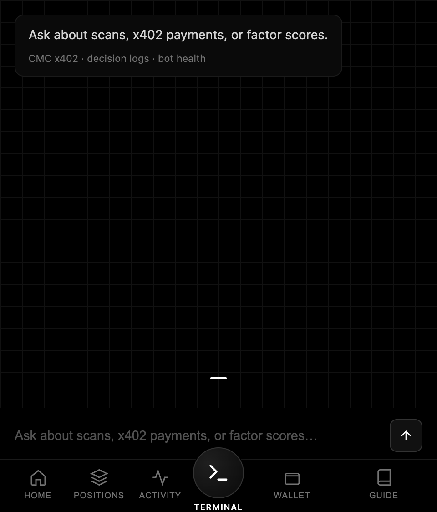

<div align="center">

# NoNamedBot



_An autonomous BNB Chain trading agent with momentum signals, CoinMarketCap data, and TWAK self-custody execution._

</div>

Run in paper-trading mode with Python 3.12:

```bash
git clone https://github.com/AlejoReyna/NoNamedBot.git
cd NoNamedBot
python3 -m venv .venv
source .venv/bin/activate
pip install -r requirements.txt
cp .env.example .env
python -m src.main --paper-trade
```

Market-data and wallet configuration is documented in the [technical reference](./DEVELOPMENT.md#quick-start).

<sub>[Strategy and run modes](./DEVELOPMENT.md) · [On-chain proof](./demo_artifacts/ON_CHAIN_PROOF.md)</sub>
